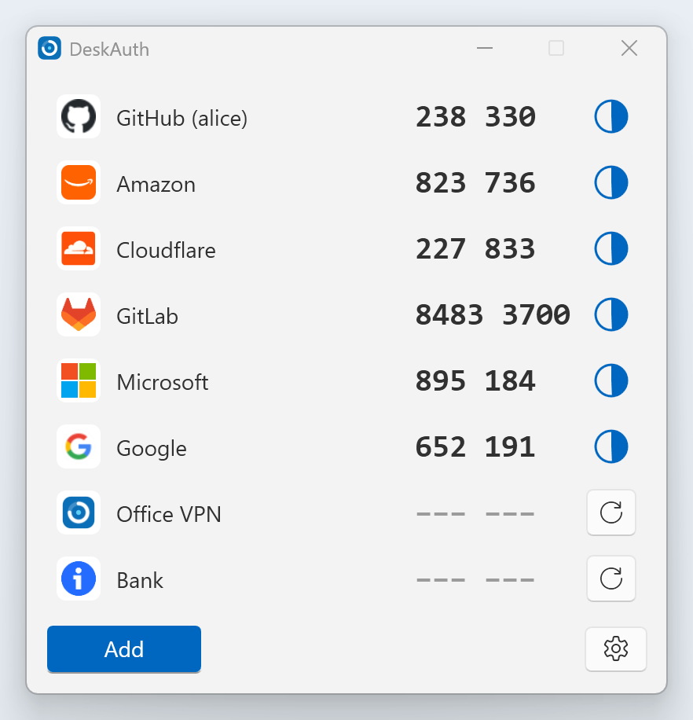
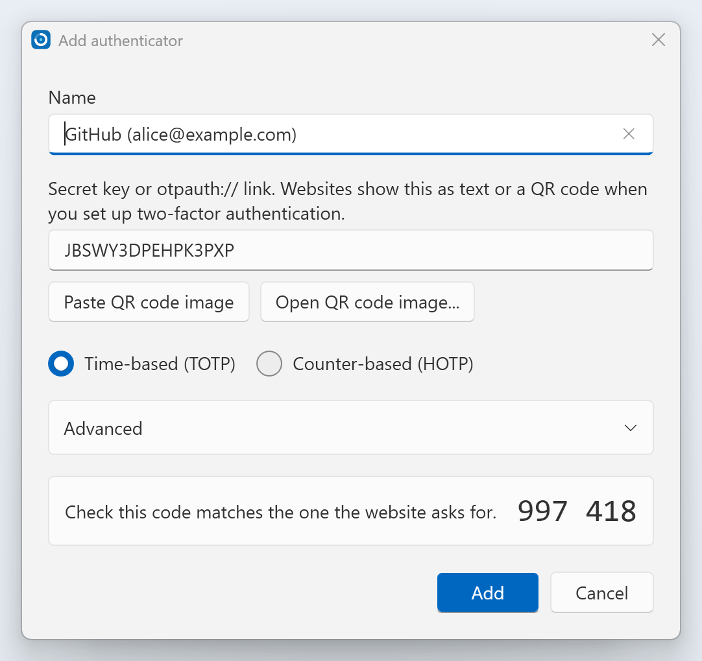
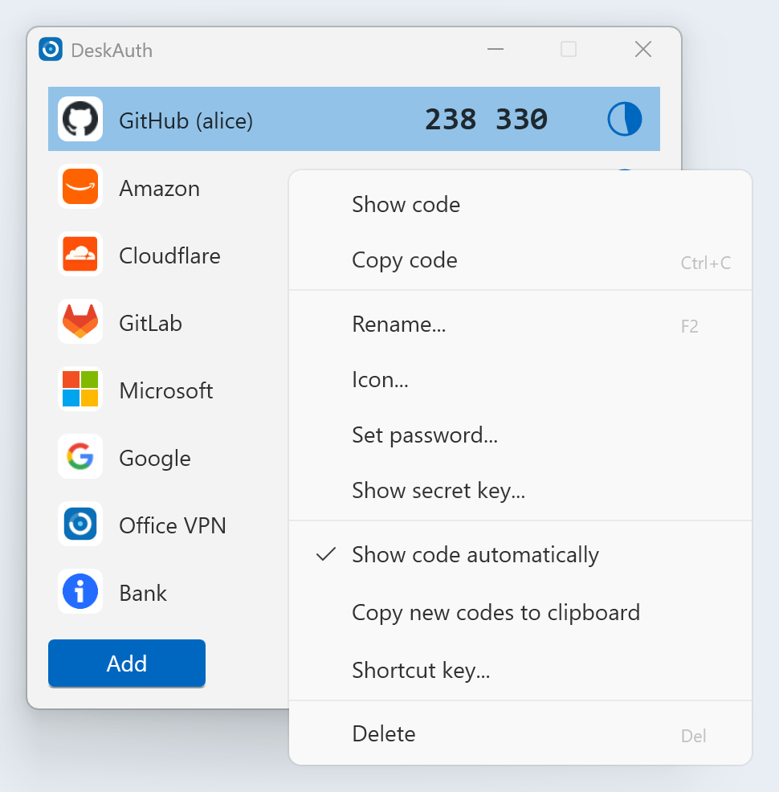
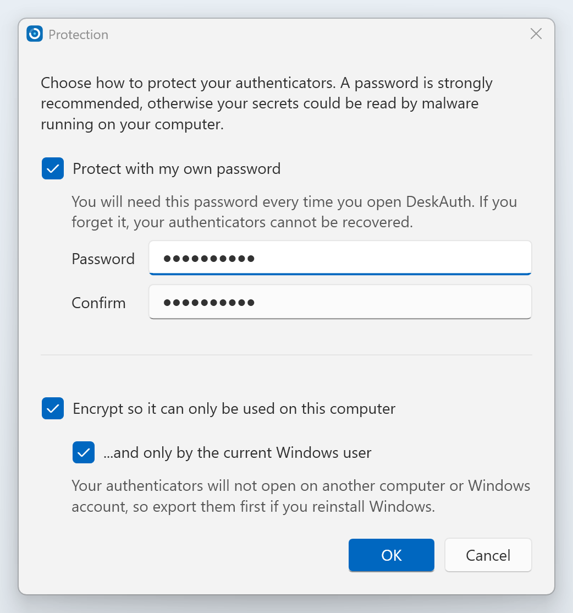
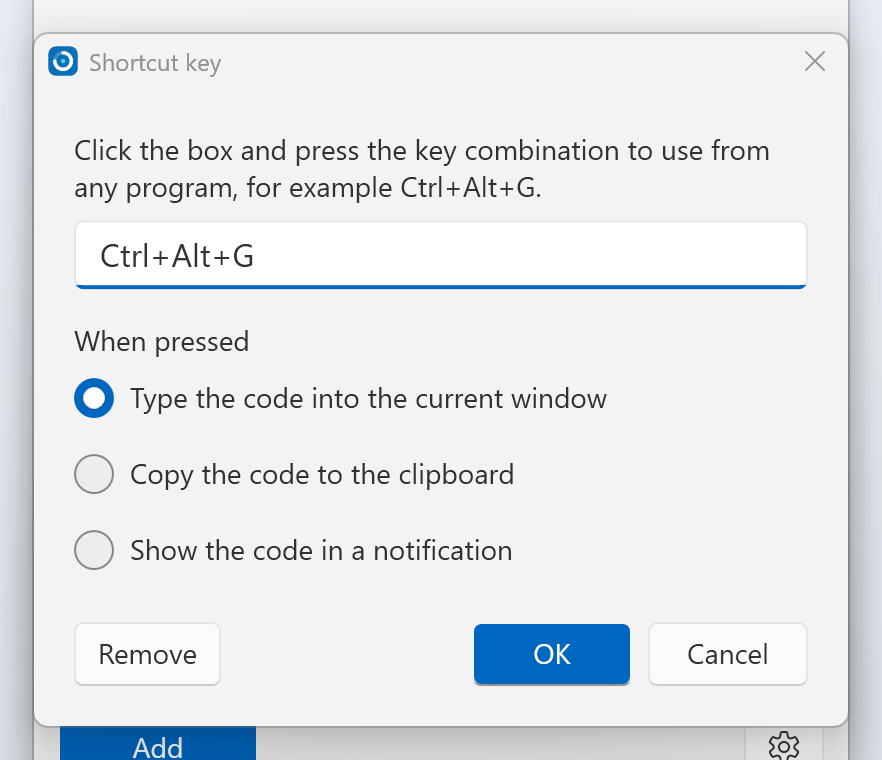
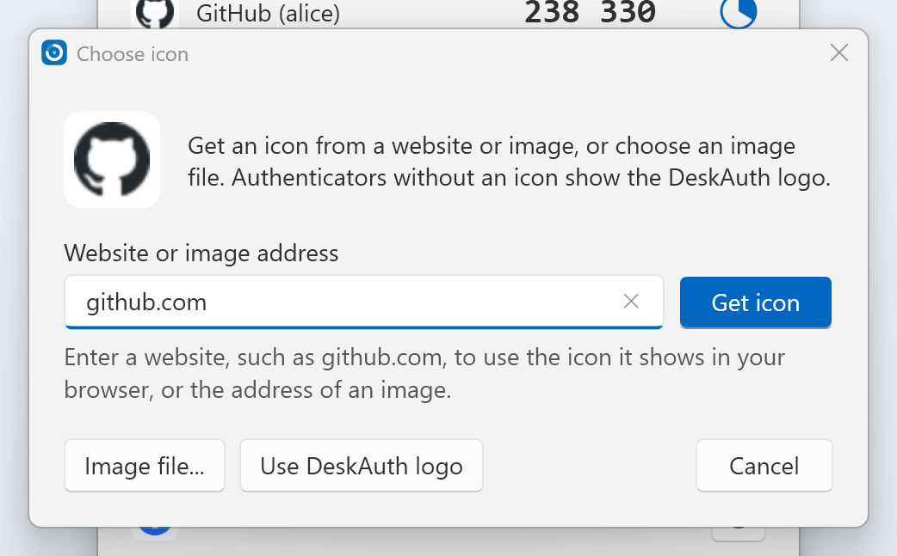
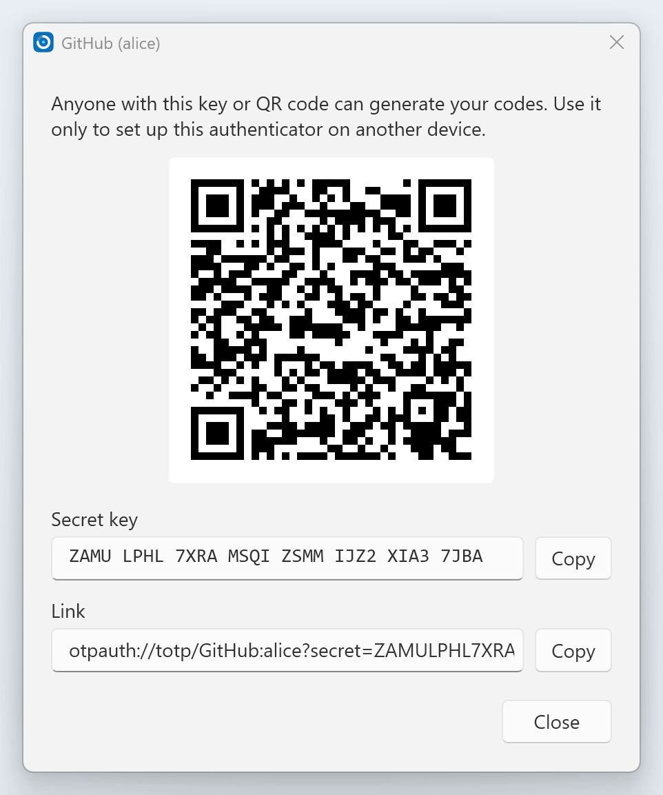

<h1> DeskAuth</h1>

DeskAuth is a portable, open-source authenticator for Windows. It generates the six or eight digit codes used for two-factor authentication by websites such as GitHub, Amazon, Microsoft, Google and Cloudflare, using the standard time-based (TOTP, RFC 6238) and counter-based (HOTP, RFC 4226) algorithms.

DeskAuth is based on [WinAuth](https://github.com/winauth/winauth) by Colin Mackie, modernized and rewritten for .NET 10 and WPF.

**[deskauth.com](https://deskauth.com/)** · **[Download](https://github.com/DeskAuth/DeskAuth/releases)** · **[Help](https://deskauth.com/help.html)** · **[Donate](https://deskauth.com/donate.html)**

<picture>
  <source media="(prefers-color-scheme: dark)" srcset="docs/images/screenshots/main-dark.png">
  
</picture>

## Features

* Time-based (TOTP) and counter-based (HOTP) authenticators, with SHA1, SHA256 or SHA512 and 6 to 8 digits
* Add authenticators from a secret key, an `otpauth://` link, or a QR code image (from a file or the clipboard)
* Codes shown continuously with a countdown, or on demand
* Your authenticators are encrypted with your password (PBKDF2-SHA256 and AES-256-GCM), and/or locked to this computer or Windows account
* An extra password on individual authenticators
* System-wide shortcut keys to type, copy or show a code
* System tray icon with quick access to codes
* Icons from a website (the icon your browser shows for it), an image address or an image file, and drag to reorder
* Import and export in the `otpauth://` format used by other authenticator apps
* Show an authenticator's secret key and QR code to move it to another device
* Light and dark themes following Windows, and sharp text at any display scaling
* Portable mode: put `deskauth.xml` next to `DeskAuth.exe` to keep everything in one folder

## Screenshots

| Add an authenticator | Right-click menu |
|---|---|
| <picture>   <source media="(prefers-color-scheme: dark)" srcset="docs/images/screenshots/add-dark.png">    </picture> | <picture>   <source media="(prefers-color-scheme: dark)" srcset="docs/images/screenshots/menu-dark.png">    </picture> |
| Paste a secret key or `otpauth://` link, or a QR code image, and check the code before adding it. | Copy codes, rename, change icons, set passwords and shortcut keys, and show secret keys. |

| Protection | Shortcut keys |
|---|---|
| <picture>   <source media="(prefers-color-scheme: dark)" srcset="docs/images/screenshots/protection-dark.png">    </picture> | <picture>   <source media="(prefers-color-scheme: dark)" srcset="docs/images/screenshots/hotkey-dark.png">    </picture> |
| Encrypt with your password, and lock to this computer or Windows account. | Type, copy or show a code from any program with a key combination. |

| Icons from websites | Secret key and QR code |
|---|---|
| <picture>   <source media="(prefers-color-scheme: dark)" srcset="docs/images/screenshots/icon-dark.png">    </picture> | <picture>   <source media="(prefers-color-scheme: dark)" srcset="docs/images/screenshots/secret-dark.png">    </picture> |
| Use the icon your browser shows for a website, an image address, or an image file. | Move an authenticator to your phone or another computer. |

## Requirements

* Windows 10 or 11
* [.NET 10 Desktop Runtime](https://dotnet.microsoft.com/download/dotnet/10.0)

## How to use

* Run `DeskAuth.exe`. There is nothing to install.
* Click **Add** and paste the secret key or `otpauth://` link from the website, or use a screenshot of its QR code.
* Right-click an authenticator for more options, such as its icon, password, shortcut key or secret key.
* Double-click an authenticator, or press Ctrl+C, to copy its code.
* Click the gear button for program options, protection, import and export.

Command line: `DeskAuth.exe [config file] [-min]`. `-min` starts in the tray (or minimized), and is used when DeskAuth starts with Windows.

## Where are my authenticators saved?

In `%APPDATA%\DeskAuth\deskauth.xml`, unless there is a `deskauth.xml` (or WinAuth's `winauth.xml`) next to `DeskAuth.exe` (portable mode) or a file is given on the command line. The previous version of the file is kept as `deskauth.xml.bak` each time it is saved.

## Upgrading from WinAuth

The first time DeskAuth runs, it copies your authenticators from WinAuth's `%APPDATA%\WinAuth\winauth.xml` to `%APPDATA%\DeskAuth\deskauth.xml`, keeping your password and Windows account protection. Your WinAuth file is not changed. DeskAuth saves with a new, stronger encryption format, which **WinAuth 3 cannot open**.

Changes from WinAuth 3:

* Only standard TOTP and HOTP authenticators are supported. Battle.net, Steam, Guild Wars 2, Trion/Glyph and other service-specific authenticators have been removed. They are kept in the file and listed as not supported, so you can still delete them; to keep using them, move them to their official apps first.
* YubiKey protection has been removed. Files protected with a YubiKey must have it removed using WinAuth 3 first.
* Codes use your computer's clock, which Windows keeps in sync. DeskAuth no longer contacts Google to check the time.
* Export is to a plain text file of `otpauth://` links. Password-protected zip and PGP exports and the registry backups have been removed.
* Shortcut keys can type, copy or show the code. Advanced shortcut scripts are no longer supported and fall back to typing the code.

## Building

See [COMPILING.md](COMPILING.md).

## Is it secure?

An authenticator on your computer is not as secure as a separate device such as a phone or hardware key: anything that can read your files and watch you type your password could read your secret keys. Protect DeskAuth with a password, keep your computer free of malware, and keep a backup of your secret keys somewhere safe.

DeskAuth never sends your authenticators, codes, secret keys or passwords anywhere. It connects to the internet only when you use **Get icon** to download an icon from a website you enter, when it starts to check GitHub for a newer release (you can turn this off in the options menu), and, if you agree when it first opens, to send anonymous usage statistics once a day: a random install ID, the DeskAuth version, and the Windows version and processor type. See the [privacy notice](https://deskauth.com/privacy.html).

To report a security problem, email **security@deskauth.com** rather than opening a public issue. See the [security policy](SECURITY.md).

## Code signing policy

Free code signing provided by [SignPath.io](https://signpath.io), certificate by [SignPath Foundation](https://signpath.org). Releases are built from this repository by GitHub Actions, and each is approved before signing. See the [code signing policy](https://deskauth.com/code-signing.html) for what is signed, the team roles and privacy.

## Removing DeskAuth

There is nothing to uninstall. Untick **Start with Windows** in the gear menu, exit DeskAuth, then delete `DeskAuth.exe` and the `%APPDATA%\DeskAuth` folder. Export your authenticators first if you might need them: once deleted, they cannot be recovered. See [removing DeskAuth](https://deskauth.com/help.html#removing).

## Donate

DeskAuth is free and open source. If it's useful to you, donations are welcome. Send only the currency shown, on the network shown; QR codes are on the [donate page](https://deskauth.com/donate.html).

| Currency | Address |
|---|---|
| Bitcoin (BTC) | `34AbSsvYt3J2yDngpUqkDqFAgUyqi4B96c` |
| Ethereum (ETH) | `0x8516c860546e73a05449EE403560CCE83e490275` |
| Litecoin (LTC) | `MMnVCoc5ZVBa1ng8a584uECS5tzZbC6guo` |
| Dogecoin (DOGE) | `DF8j85GGQk5h138FkRZn4Y8vckNHwYqrbv` |
| Shiba Inu (SHIB, ERC-20 on Ethereum) | `0x9CE95b4b826Dc0Af4823ec3625f641d074FA477F` |

## Author

DeskAuth is maintained by Nick Morphis and contributors. Copyright (C) 2026 Nick Morphis and contributors. Contact: contact@deskauth.com.

DeskAuth is based on [WinAuth](https://github.com/winauth/winauth), written by Colin Mackie. Copyright (C) 2010-2017 Colin Mackie. DeskAuth modified WinAuth in 2026, rewriting it for .NET 10 and WPF.

## License

This program is free software: you can redistribute it and/or modify it under the terms of the GNU General Public License as published by the Free Software Foundation, either version 3 of the License, or (at your option) any later version.

This program is distributed in the hope that it will be useful, but WITHOUT ANY WARRANTY; without even the implied warranty of MERCHANTABILITY or FITNESS FOR A PARTICULAR PURPOSE. See the GNU General Public License for more details.

You should have received a copy of the GNU General Public License along with this program. If not, see https://www.gnu.org/licenses/.
